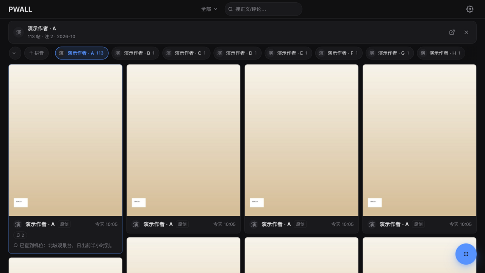
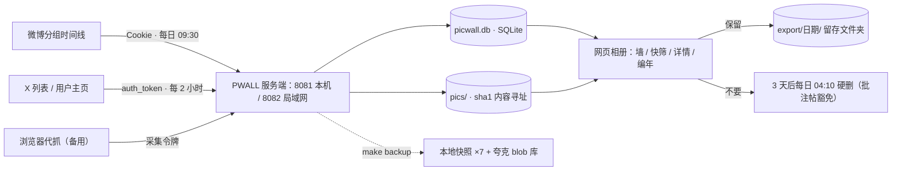

# Picwall — 微博分组图片墙

每天抓一次你在微博配置分组里关注人（以及 X 列表/用户）发的**图片**，落地到本地，配一个网页相册快速过图：
保留好看的（跳回原微博转发评论）、删掉一般的、原图随时下载/打包带走。
仓库自包含：服务端、浏览器扩展、运维工具与文档都在本仓库内，不依赖其他工程。项目名 **Picwall**，服务/界面/命令标识 **PWALL**，文档中两者混指同一系统。当前基线：**v0.5.7 / schema v11**。

本文是**入口**：上手、配置、采集、数据与文档体系。日常功能的行为与键位见 [使用手册](docs/user-guide.md)。

**系统全景**（采集 → 存储 → 使用 → 归宿 → 备份）：

> **声明**：本项目通过微博 / X 的**非官方接口**读取你自己账号的时间线，仅供个人本地部署与学习研究。
> 接口随平台改版可能失效，账号使用风险自担；使用时请遵守所在平台的服务条款与当地法律，勿用于批量抓取、转售或任何侵犯他人权益的用途。项目与微博 / X 官方无关联。

## 1. 快速开始

| 入口 | 地址 | 说明 |
|---|---|---|
| 本机 | <http://localhost:8081> | 直进管理界面，无需配对（只绑回环地址） |
| 局域网 | `http://<Mac的IP>:8082` | 手机/平板；设备配对保护帖子、媒体、导出与管理 API（只读设备也要配对） |
| 存活检查 | `/api/health` | 只返回版本与存活状态 |

四步上手：

1. **拉起**：仓库根目录跑 `make picwall`（首次构建镜像约一分钟；会自动重打包浏览器扩展、探测局域网 IP 并等健康检查通过）。
2. **配对设备**（可选）：设备打开 8082 页面填配对码，或直接扫右上角二维码。配对码两个来源：

   | 来源 | 取法 | 说明 |
   |---|---|---|
   | 固定配对码 | `.env` 的 `PWALL_PAIR_CODE`（`PWALL_PAIR_ROLE` 定角色，默认分拣） | 长期有效、可重复使用；换码不影响已配对设备，可在「设备」里逐个撤销 |
   | 临时配对码 | 终端 `make picwall-pair`（`ROLE=admin`/`viewer`），或本机二维码弹窗里「生成配对码」 | 限时 10 分钟、仅可用一次 |

   会话有效期 30 天；本机可在齿轮 →「设备」取消其他设备配对。建议固定码 ≥12 位——弱码在配对限流上限（约 1.4 万次/天）内可被穷举，过短时启动日志与 `/api/status` 会告警。
3. **连接微博 / X**：右上角「Cookie」→ 下载「PWALL Cookie 助手」扩展并按三步装入：
   - 在助手内填 PWALL 地址，用管理配对码配对并允许访问该地址；
   - 分别发送微博与 X 的登录 Cookie，服务端校验通过即保存（X 尚未添加列表时显示「已保存 · 待验证」）；
   - 弹窗按平台展示连接状态与最近检查时间，可单独「重新检查」。

   手动备用：微博完整 Cookie、X 完整 Cookie 或 auth_token（新版扩展同时发 ct0）；校验失败保留旧凭据，网络异常、限流与登录失效分别处理。改 `.env` 的 `WB_COOKIE` 走 `make picwall`（`docker compose restart` 不重读 .env；网页清除 Cookie 后界面会显示回退配置等待重新校验）。
4. **选分组与博主**：齿轮「管理分组」→「拉取分组」，后台自动拉取并全部导入；亦可在管理分组中直接填入微博博主 UID/主页链接（`wbu:<uid>`）或 X 用户名（`xu:<handle>`）添加单博主目标，完成后首页「立即抓取」。新目标首次抓取自动回补近 30 天（逐页回翻到窗口边界，页数有硬上限）。之后每天 `CRAWL_TIME`（默认 09:30 东八区）自动抓一次。

**网络与安全**：HTTP 面向可信私网，不提供传输加密；跨网访问（蒲公英/Tailscale 等组网）时 8082 的登录会话与 Cookie 助手发送的凭据都在明文链路上走，建议优先 Tailscale 加密隧道（组网迁移仍是待决项，见[风险分析](docs/2026-10-13-风险分析.md) F3），组网成员可信度自行把关。非默认主机名需 `.env` 设 `PICWALL_ALLOWED_HOSTS`（逗号分隔）后再 `make picwall`。

## 2. 能力地图

想做什么 → 去哪里；行为与键位详见[使用手册](docs/user-guide.md)对应节：

| 想做什么 | 入口 / 键位 | 手册 |
|---|---|---|
| 过图分拣（保留/不要） | 悬浮球「快筛」/ `Shift+Q`；或点卡进详情 | [§2](docs/user-guide.md#2-分拣快筛) |
| 看某博主全部内容 | 点卡片或详情里的博主头像；或筛选面板「博主」行（`Shift+F`） | [§1.4](docs/user-guide.md#14-博主视图) |
| 按时间线过图 | 视图面板「布局 → 编年」/ `V` | [§1.5](docs/user-guide.md#15-编年视图桌面端) |
| 逛博主杂志墙（报刊亭） | 左轨「报刊亭」/ `/kiosk` | [§1.7](docs/user-guide.md#17-报刊亭博主杂志墙) |
| 看回看/入库统计报告 | 左轨面板「回看统计」/ `/stats` | [§1.9](docs/user-guide.md#19-统计室回看报告) |
| 看大图 | `空格`；纯图模式下直接点图（跨帖连看） | [§3.1](docs/user-guide.md#31-大图) |
| 全屏放映当前筛选结果 | 悬浮球「放映」 | [§3.2](docs/user-guide.md#32-放映) |
| 写批注 / 翻批注流 | 详情右栏；悬浮球「批注」 | [§4.2](docs/user-guide.md#42-批注评论)–[4.3](docs/user-guide.md#43-批注流) |
| 重温保留过的图 | 悬浮球「回看」 | [§4.4](docs/user-guide.md#44-回看) |
| 收藏 | `M`（详情/大图/放映） | [§4.1](docs/user-guide.md#41-收藏) |
| 打标签 / 按标签看图 | 详情「＋ 标签」；筛选面板「标签」行；多选模式「标签」批量打标 | [§1.8](docs/user-guide.md#18-标签打标与筛选) |
| 批量下载 / 多选 | 齿轮「批量下载」；长按卡片多选 | [§5.1](docs/user-guide.md#51-批量下载) |
| 纯图刷图 | 悬浮球切纯图模式，点图直进大图 | [§1.6](docs/user-guide.md#16-纯图模式) |
| 手机上用 | 局域网 8082 + 配对；手势与存图见手册 | [§6](docs/user-guide.md#6-手机端) |

## 3. 配置（docker-compose.yml 环境变量）

| 变量 | 默认 | 说明 |
|---|---|---|
| `WB_COOKIE` | 空 | 微博 Cookie；网页里保存的优先于这里 |
| `CRAWL_TIME` | `09:30` | 每日抓取时刻（HH:MM，东八区） |
| `CRAWL_MAX_PAGES` | `2` | 日常每分组最多翻几页（每页约 20 条） |
| `CRAWL_BACKFILL_DAYS` | `30` | 新分组首次抓取自动回补多少天 |
| `CRAWL_BACKFILL_MAX_PAGES` | `100` | 回补翻页硬上限（防失控） |
| `X_CRAWL_INTERVAL_HOURS` | `2` | X 定时抓取间隔小时数（0=关闭） |
| `X_PROXY_URL` | 空 | X 抓取专用代理（容器内直连 x.com/twimg 被墙时配）；只影响 X 链路 |
| `PURGE_DAYS` | `3` | 「不要」多少天后自动硬删 |
| `PICWALL_MAX_IMAGE_PIXELS` | `100000000` | 单图像素上限（解码保护）；拼接巨图按需放宽 |
| `PICWALL_MAX_VIDEO_BYTES` | `536870912` | 单个视频体积上限（X 视频帖）；超限的视频自动跳过 |
| `PWALL_PAIR_CODE` / `PWALL_PAIR_ROLE` | 空 / `editor`（分拣） | 固定配对码与角色（建议 ≥12 位） |
| `PICWALL_ALLOWED_HOSTS` | 空 | 非默认主机名白名单（逗号分隔） |
| `PICWALL_LAN_IP` | 自动 | `make picwall` 启动时探测注入（扫码地址用），无需手配 |
| `TZ` | `Asia/Shanghai` | 固定值；业务日界东八区，不随宿主时区 |
| `PICWALL_BLOB_STORE` | `local` | **宿主侧**备份用（make backup / picwall-cloud），与容器无关；`quark` 直传夸克 |

除 `PICWALL_BLOB_STORE`（宿主侧）外，以上变量都在 compose `environment` 白名单内声明，`.env` 修改后 `make picwall` 重建生效。**新增环境变量必须显式声明进 compose，否则容器看不见**——配了等于没配（历史踩过的坑，测试兜底：`tests/test_docs.py` 的环境变量契约）。

## 4. 采集链路

三条通道汇合同一个图片墙（后端结构见[架构总览](docs/architecture.md) §6）：

- **微博服务端抓取（默认）**：Cookie 校验通过后每天 `CRAWL_TIME` 自动抓已导入分组与微博博主（`wbu:<uid>`）；齿轮「自动抓取」弹窗实时显示分组/页数/新增计数，可手动「立即抓取」。抓取区分成功/部分成功/失败，最近尝试与最近成功分别记录，Cookie 过期不会覆盖成功时间。
- **X 服务端抓取（推荐）**：扩展发来 `auth_token` 后，服务端用移植自 gallery-dl 的 GraphQL 客户端（`app/sources/xapi.py`）定时抓已启用的 X 目标——**列表**（`x.com/i/lists/<id>`，分组 id `x:<id>`）与**用户主页**（管理分组里填 @用户名添加，分组 id `xu:<handle>`，先实连校验存在并自动缓存数值 rest_id 节省 50% 请求配额；遇 429 限流自动熔断跳过当轮后续目标）。视频帖一并入库（video_info 变体取最高码率 mp4，海报作封面；体积受 `PICWALL_MAX_VIDEO_BYTES` 限制）。容器内直连被墙时配 `X_PROXY_URL`；首页「立即抓取」按已配置来源智能触发（可直接抓 X），管理分组支持对 X 列表与博主点击「回补」深度翻页抓取。凭据也可 `make picwall-safari-cookie` 从本机 Safari 现取（终端需「完全磁盘访问」）。X 强制登录，匿名抓取不可行；改版导致失败时升级 gallery-dl，对照更新 `ENDPOINTS/FEATURES` 常量与浏览器 UA。
- **浏览器代抓（无 Cookie 备用）**：服务端没 Cookie 时由已登录浏览器代抓——微博在已登录页面同源翻页后 `POST /api/ingest/harvest`（body: `list_id`/`name`/`statuses`）；X 把 `tools/x-collector.js` 粘进 x.com 的 Console 被动拦截页面请求（满 30 条自动推送，`pwXFlush()`/`pwXStop()` 手动控制）。两者都需 `make picwall-collector-token` 生成的**仅可导入**令牌（不写入仓库或聊天）；单批 ≤100 条、请求体 ≤2 MiB，CORS 只放行对应平台。图片由服务端直连下载（微博无需 Cookie）；服务端不硬编码任何 GraphQL queryId，页面结构变化最坏是部分推文被安全跳过。定时自动抓仍需正常填 Cookie。

## 5. 数据、备份与隐私

| 路径 | 内容 | 入 git |
|---|---|---|
| `data/picwall.db` | SQLite（WAL），唯一存储 | 永不 |
| `data/pics/` | 图片，内容寻址 `年/月/<sha1>.jpg`，同一张图多个分组只存一份 | 永不 |
| `data/export/` | 保留帖归档（按日期）；手机相册/网盘同步这里 | 永不 |
| `data/cookie.txt` / `x_auth.txt` | 平台凭据（0600） | 永不 |
| `data/backups/` | 本地快照（留最近 7 份；凭据只进快照的 `local/` 子目录，**永不进 blob 库、不上云**） | 永不 |

- **备份（v2）**：`make picwall-backup`（= `make backup`）三路备份图片墙——db 快照与凭据留本地，媒体 blob 按 sha256 内容寻址直传夸克网盘；manifest 是 hash 清单，恢复逐文件校验、全有或全无，服务运行中执行也安全（blob 默认落本地，`.env` 设 `PICWALL_BLOB_STORE=quark` 直传夸克）；恢复演练 `make picwall-restore-test`；blob 库同步/回验 `make picwall-cloud`。方案详见[夸克网盘备份方案](docs/2026-10-10-夸克网盘备份方案.md)。
- 备份无独立定时：`make picwall` 拉起时若最新快照超 24 小时自动补一轮；`make status` 速览容器与快照新鲜度（超 24 小时提示补备份）。
- **升级自动迁移**：库结构带版本号（meta.schema_version），升级程序后首次启动做增量迁移，无需删库重抓（v2 收藏与来源 · v3 补抓队列与分页索引 · v4 决定版本与媒体校验 · v5 设备配对 · v6 回看计数 · v7 帖子评论 · v8 备份云端登记 · v9 X 本地分组 · v10 帖子标签；机制见[架构总览](docs/architecture.md) §3）。
- **补抓与修复**：缺图自动补抓 + 顶部「补抓图片」手动重试（节奏与上限的数字以[手册 §5.3](docs/user-guide.md#53-缺图补抓)为唯一来源，此处不重复）；缺图补抓和归档重试先返回任务编号再后台执行，重复点击不会重复派发，`/api/jobs/media` 与 `/api/jobs/archive` 核对状态（受设备权限保护），重启把未结束任务记为「已中断」。`make picwall-health` 深度体检原图/缩略图/头像/历史归档；`make picwall-repair` 只修复可重建内容，保留用户决定；体检「完成」指检查结束——历史缺失不会被当作已补齐。
- **在线维护约定**：备份/体检/设备签发命令自动在运行中的 PWALL 容器内执行并核对数据挂载；无法核对 Docker 状态时命令停止，不猜测服务已停机。回滚=用更新前的完整快照恢复到空目录、核验后再切换数据目录（移动 data/ 先 `docker compose down`）。
- **数据全丢 / 换机（最坏场景）**：新目录空仓 → `make picwall-cloud` 回验云端 blob 可读 → 用最新快照恢复到空目录（`tools/restore.py`，逐文件 sha256 校验、凭据从快照 `local/` 回源）→ 核对 `/api/status` 与决定计数 → 停旧容器、切换数据目录、`make picwall`。完整设计见[夸克网盘备份方案](docs/2026-10-10-夸克网盘备份方案.md)。

Cookie 等同登录态，别外传；相册只在局域网访问，不上公网。

## 6. 操作与排障速查

| 命令 | 用途 |
|---|---|
| `make picwall` | 重建+拉起（改了 .env/CRAWL_TIME 后也跑这条） |
| `make picwall-logs` | 跟踪日志 |
| `make picwall-test` | 单测 + lint（宿主 .venv；改完代码先跑这条再 make picwall） |
| `make picwall-preview` | 临时演示数据的浏览器验收实例（18081 端口，退出自动销毁） |
| `make picwall-benchmark` | 只读快照测查询（`GROWTH=1` 测 2 万帖模拟增长） |
| `make picwall-backup` / `picwall-restore-test` / `picwall-health` / `picwall-repair` | 备份 / 恢复演练 / 深度体检 / 修复 |
| `make picwall-cloud` | 备份 blob 库同步夸克（首传/续传/抽样回验/prune） |
| `make picwall-pair` / `picwall-collector-token` / `picwall-safari-cookie` | 配对码 / 采集令牌 / Safari 现取 X 登录态 |
| `make picwall-audit` | 媒体只读审计（体积/重复/库-磁盘一致性） |
| `make picwall-stop` / `make status` | 停止服务 / 状态速览（容器 + 备份新鲜度） |

**排障速查**（约定：错误详情写进状态页而非日志，先 `/api/status` 再容器日志）：

| 症状 | 先看 | 处置 |
|---|---|---|
| 顶部「登录失效」提醒；拉取分组失败 | 来源连接状态 | Cookie 助手重发或在来源连接中更新；改 `.env` 的 `WB_COOKIE` 后 `make picwall` |
| 「图片待补齐」横幅不消 | `/api/jobs/media` | 等自动补抓（节奏见[手册 §5.3](docs/user-guide.md#53-缺图补抓)），或顶部「补抓图片」手动重试 |
| 抓取零新增 / 失败 | `/api/status` 的 `last_error` / `x_last_error` | 按 cookie/限流/结构错误分别处置；再看 `make picwall-logs` |
| X 抓取报 SSL/连接失败 | 容器直连 x.com 被墙 | `.env` 配 `X_PROXY_URL`（如 `http://host.docker.internal:7897`）后 `make picwall` |
| `make status` 备份新鲜度变黄 | `data/backups/` 最新批次 | `make backup`；云端落后再 `make picwall-cloud` 续传 |
| 设备打不开 8082 | IP 是否变了、主机名是否登记 | 二维码弹窗改成新 IP；`.local` 名登记 `PICWALL_ALLOWED_HOSTS` |
| 固定配对码弱码告警 | `/api/status` 告警标志 | `.env` 换 ≥12 位码后 `make picwall`（已配对设备不受影响） |
| 升级后起不来、报 schema 版本 | 版本前向拒绝（新库旧程序） | 用配套版本运行；回滚走完整快照恢复到空目录 |

## 7. 已知边界

- **视频帖**：X 视频与 GIF 已支持入库（mp4 变体最高码率，封面用推文海报；放映里以海报静帧出场，大图/详情可内嵌播放）；**微博视频仍跳过**（视频链路另议），纯文字帖两种来源都不收。
- **去水印不做**：个别水印是上传者开启水印功能时**烧进像素**的，换 URL/尺寸都去不掉；抹除属于破坏作者署名。
- **原图档**：入库统一取微博最高质量 `/large/` 档（largest > large > mw2000，orj960/sti960 等缩放档一律改写）；`/large/` 即微博保留的最高质量版本，并非上传者手中的未压缩原始文件。存量已用 `tools/migrate_to_large.py` 一次性重取（幂等可重跑）。
- 微博网页版 ajax 接口是非官方接口，需登录 Cookie；**登录失效**时相册顶部提醒，可扩展重发或在来源连接中更新。「拉取分组」失败通常是 Cookie 过期或失效。
- 只收带媒体帖：微博只收带图（纯文字/视频帖跳过），X 带图与视频都收（见上条）。详情正文按时间线原样入库，**长微博只有截断部分**（看全文点「原博 ↗」）。
- 待决事项：真实手机备份恢复验收未完成（[风险分析](docs/2026-10-13-风险分析.md) F12）；跨网组网迁移待三选一（F3）。

## 8. 文档体系（本文如何被维护）

文档分三层：**活文档**（README + 使用手册 + 架构总览，随代码走）← **dated 审查**（某时点的深度决策记录）← **verification 证据**。每份的「何时更新」就是它的维护契约：

| 文档 | 定位 | 何时更新 |
|---|---|---|
| 本文 README | 入口：上手/配置/采集/数据/文档体系 | 用户可见行为、配置面、运维面变化时改对应节 |
| [使用手册](docs/user-guide.md) | 日常功能行为与键位的完整参考（活文档） | 功能/交互变更时随功能提交同步 |
| [架构总览](docs/architecture.md) | 模块/数据模型/锁/调度/备份的当前事实（活文档） | 后端结构变更**先改它**再合码 |
| [迭代日志](docs/CHANGELOG.md) | 每次迭代一条（append-only，正序追加在文末） | 每次迭代含小修 |
| `docs/YYYY-MM-DD-标题.md` | 某时点的深度审查与决策（风险分析/数据审查/方案） | 风险排查或深挖时新建；结论写在开头 `[!summary]` |
| `docs/verification/` | 各轮验收证据（截图 + summary.md） | 每轮功能验收后新建 `YYYY-MM-<slug>/` 子目录 |
| [SPRINT.md](SPRINT.md) | 冲刺路标（迭代记录已迁出） | 开新一轮冲刺时 |
| [project_atlas.html](docs/project_atlas.html) | 单文件交互式架构看板（生成物：模块卡下钻 Why/How/Contract/Data/Gotchas + 数据流图）；线上从 PWALL 设置 → 开发管理进入（/atlas，仅管理设备） | 代码结构或符号行号变化后重新生成对应数据，`scripts/verify_atlas.py` 校验（±10 行） |

更新规则（情况 → 动作）：

1. **用户可见的功能/交互变更** → 同一提交改 README 对应节 + 使用手册对应节（界面大改时同步更新手册内嵌截图，图注保留时点）；跨文档节号引用一律用锚链接（死链测试连锚点一起校验）；大功能来不及可当日「文档汇总」提交兜底，但 CHANGELOG 必有对应条目。
2. **后端结构变更**（schema/模块分层/API/锁/备份格式）→ 先改架构总览（含基线版本行），再合代码。
3. **配置/运维面变更**（环境变量/compose/Makefile 目标）→ 同步本文 §3/§6。
4. **每次迭代（含 bug fix）** → CHANGELOG 文末追加一条：交付了什么 + 修了什么 + 验证计数。
5. **功能验收** → `docs/verification/YYYY-MM-<slug>/`：截图 + summary.md（环境 / 覆盖项表 / 边界与留白 / 测试）。
6. **风险排查 / 深度审查** → 新建 dated 文档（frontmatter `title`/`description`/`date` 三件套）；不构成新文档的迭代事实只进 CHANGELOG。
7. **dated 文档退役** → 删除前回改全部引用（死链由 `make picwall-test` 的文档链接检查兜底），未闭合结论回流活文档，原文留在 git 历史。
