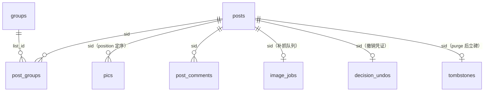

# Picwall 架构总览

> [!summary] 本文定位
> 随代码走的**活文档**：读完能知道系统由哪些模块组成、数据长什么样、并发/调度/备份如何协作。
> 与 dated 审查文档的分工——那边是「某时点的深度审查与决策记录」，这边是「当前事实」。
> 代码事实基线：**v0.5.7 / schema v11（2026-11-12）**；结构变更时先改本文。

## 1. 部署形态

- **单容器单进程**：FastAPI + uvicorn，APScheduler `AsyncIOScheduler` 挂在同一事件循环上（`app/server.py` 模块 docstring）。无外部服务依赖，SQLite 是唯一存储。
- **双监听器**（`app/serve.py::server_configs`）：同一 app 跑两个 uvicorn 监听器，共用一次数据库与调度器生命周期。
  - Docker（默认部署）：`127.0.0.1:8081 → 容器 8082`（LocalOwner 本机入口）+ `8082 → 容器 8080`（局域网配对入口）——映射见 `docker-compose.yml`。
  - 裸进程：`127.0.0.1:8081`（LocalOwner）+ `0.0.0.0:8082`（局域网）。
  - 本机管理员权限来自**监听器注入的 scope 标记**（`LocalOwner`），不能由客户端 Host、IP 转发头或 Cookie 声明。
- **数据全在 `data/`**（永不入 git）：`picwall.db`（SQLite，WAL）+ `pics/`（内容寻址 `年/月/<sha1>.jpg`）+ `export/`（保留帖归档）+ `cookie.txt` / `x_auth.txt`（0600 凭据）+ `backups/`。
- 业务日界固定东八区（`config.NOW_TZ`），不依赖容器时区。

## 2. 模块分层

import 关系是单向 DAG，无循环依赖：

```
config（叶子：环境变量→模块常量、平台数据目录、密钥文件读写）
  └─ gate（进程内 + 跨进程可重入锁，db 与文件侧共用）
       ├─ db / queries / weibo / media_fetch / sources.base     ← 数据与平台原语
       ├─ storage / capture_result / auth / cloud / connections / jobs
       │       ├─ crawler / purge / downloads / demo / maintenance / backup
       │       └─ sources.x / sources.xapi
       └─ server（组合根）→ serve（双监听器入口）
```

| 模块 | 职责一句话 |
|---|---|
| `db.py` | 全部 DDL + 存取 + 幂等迁移 + 不变量触发器 |
| `storage.py` | 图片落盘（sha1 内容寻址）、缩略图、归档导出与校验、文件名清洗（唯一清洗点） |
| `crawler.py` | 抓取编排：分页/回补/断点续传/补抓队列/进度 state |
| `weibo.py` | 微博 ajax 客户端 + 防御式解析（纯函数层） |
| `sources/` | 平台适配：`base.py` 契约与错误分类；`xapi.py` 服务端 GraphQL 客户端；`x.py` 浏览器代抓归一化 |
| `cloud.py` | 备份 blob 库双后端抽象 `LocalBlobs` / `QuarkBlobs` |
| `backup.py` | 快照 create/restore：manifest + sha256，全有或全无 |
| `auth.py` | 设备配对/会话（只存哈希）、请求体积中间件、角色写权限矩阵 |
| `gate.py` | `DataGate`（flock）+ `WriteLock` 组合锁 |
| `connections.py` | 凭据规范化/探活/状态指纹，绝不返回凭据 |
| `jobs.py` | 长维护任务持久化 Runner（先登记再执行） |
| `purge.py` | 过期硬删 + 引用计数保图 + 墓碑 |
| `maintenance.py` | 可重建媒体修复与深度体检 |
| `downloads.py` / `queries.py` | 打包计划与筛选条件构造（列表/打包共用） |
| `media_fetch.py` | SSRF 防护的媒体下载：域名白名单 + 重定向逐跳重验 + 体积/像素预算 |
| `demo.py` / `capture_result.py` | 演示数据；采集结果口径（received/accepted/failed…） |

已解决与已知结构软点（改动前先读）：

- `server.py` 路由解耦：`_crawl_x` 与 `ingest_harvest` 的核心流水线已收敛至 `crawler.py`（`crawler.crawl_x` 与 `crawler.ingest_harvest`），`server.py` 路由仅保留 HTTP 参数校验与响应封装。
- 锁语义规范化：`db.py` 导出了规范锁别名 `write_lock = _write_lock`。
- `storage.py` 对 db 的 import 推迟到函数体内（7 处），防御式解耦。
- `downloads.py` import 了 `fastapi.HTTPException`，web 框架漏进数据层。

前端侧（`app/static/`，原生 ES Modules，app.js 为组合根）。独立子页（`/kiosk`、`/stats`）走
同一模式：Jinja 模板自带内联样式（不依赖 style.css）、独立 ES Module、`?v=` 版本号、
no-cache HTML；页面数据走各自的 JSON 端点（kiosk→`/api/authors/kiosk`，stats→`/api/stats`），
重查询一律 `asyncio.to_thread`。编年时间线（`timeline.js`）不在
app.js 里另起取数链路——收卡口挂在 `appendToShortestCol` / `insertCardAt` / `ensureFeedCols`
三处编年守卫上，卡片渲染、乐观标记、大图/详情全复用墙链路；按日聚合数据走
`GET /api/timeline/outline`（与 `/api/posts` 同一 `post_filter` 筛选口径，日界=
`substr(created_at,1,10)`，依赖库内 created_at 统一东八区 ISO8601 的既定不变量）。
博主视图（`author-view.js`）同理不另起页面：卡片/详情头像进入 = `S.author` 钉住 +
状态与伴随筛选归位，墙照旧；头部条显隐单一事实源是 `S.author`，`load(true)` 统一 sync，
统计走 `GET /api/authors/{key}/profile`（`db.author_profile` 纯本地聚合，
key = author_key 口径；微博签名沿用既有 `/api/authors/{uid}/bio`，网络请求分开调）。

## 3. 数据模型（schema v11）

20 张表按域分组：

| 域 | 表 | 说明 |
|---|---|---|
| 内容 | `posts` `pics` `groups` `post_groups` `post_observations` | 帖子/图/分组；`post_groups` 支持一帖多分组，`post_observations` 记各分组采集时的转发上下文；`pics.kind`（photo/video）区分媒体类型，视频行 `w/h`=宽高比、`thumb`=海报缩略图、`poster_url` 存海报原址（补抓自愈用） |
| 用户决定 | `decision_undos` | 撤销凭证：`decision_version` 单调递增 + 服务端保存的前状态快照，防跨端旧撤销覆盖 |
| 标签 | `post_tags` | 用户自定义归类维度（sid,tag 主键），与决定状态/收藏正交；purge 删帖时级联清理 |
| 评论 | `post_comments` | 单人批注时间线；`created_at` 首发=展示时间，编辑不漂移 |
| 回看 | `review_events` + posts 的 `keep_count/shown_count/last_shown_at/last_confirm_at` | 点赞次数（建账=1，此后每帖每天最多 +1，`_review_count` 服务层统一限流）与出场记账 |
| 媒体完整 | `media_contents` `archive_entries` `file_jobs` | 内容哈希登记、历史归档独立清单（不随帖子状态失效）、删除失败持久重试 |
| 任务 | `image_jobs` | 缺图补抓队列（时间与错误类别字段齐备） |
| 清理 | `tombstones` | 被 purge 硬删的 sid；**所有入库通道必须先拦**，防深翻页复活 |
| 设备 | `device_codes` `device_sessions` `pairing_attempts` | 配对码（哈希+四角色 CHECK）、30 天会话、配对限流 |
| 运维 | `meta` `schema_migrations` `cloud_blobs` | 键值状态、迁移记录、备份 blob 云端登记（sha256→夸克 fid） |

核心关系（完整字段见 `db.py::_SCHEMA`）：



关键约定：

- **跨来源 sid 防撞**：新来源带前缀（`x:<tweet_id>`），微博存量不带；来源以 `source` 列为准。作者键 `db.author_key(source, uid)`，非微博来源 = `source:uid`。
- **决定状态机由 DB 触发器强制**（`db.py::init_db` 末段）：status 三值、favorite 0/1、时间字段与状态的一致性，在数据库层 RAISE(ABORT)；客户端历史字段进不了恢复写入。
- **迁移是单函数幂等**（`db.py::init_db`）：`BEGIN IMMEDIATE` 逐条执行 DDL → 缺列补列 → 幂等回填 → 迁移前统计脏数据（无效决定/时间矛盾）即中止 → 记 `schema_migrations`。版本前向拒绝（新库旧程序报错）；版本号只作诊断，不分支。

## 4. 并发与锁

```
WriteLock（db._write_lock，全 app 约 30 处）
  = DataGate（跨进程 flock data/.mutation.lock，Windows 走 msvcrt）
    + threading.Lock（进程内串行化写事务）
  可重入：线程本地 depth 计数；进程锁总在文件锁之内获得
DataGate 单独使用：@guarded 装饰文件侧操作（storage、backup 固定快照）
```

- 「写文件 + 插行」跨函数单一临界区：调用方持 `_write_lock` 后用 `db._insert_pic_locked`（约定写在 `db.py` 头注释），purge 的引用计数判删与 unlink 同理全程持锁。
- SQLite：WAL + `busy_timeout=20000`；每次调用新开连接、退出即关（`db.Connection`）。
- **前提：单进程 asyncio**。将来增加 worker 时，抓取互斥、文件清理与归档锁必须一起重新设计（数据设计审查 §5 的明示边界）。

## 5. 后台任务

调度注册在 `server.py::lifespan`，misfire 宽限 1 小时（宿主睡眠跨点醒来补跑）：

| 任务 | 触发 | 说明 |
|---|---|---|
| 每日微博抓取 | cron `CRAWL_TIME`（默认 09:30） | `crawler.crawl`，有 checkpoint，断点续跑 |
| 过期清理 | 每日 04:10 | `purge.run`，`PURGE_DAYS` 阈值，收藏与共享引用保护 |
| X 列表抓取 | interval `X_CRAWL_INTERVAL_HOURS`（0=关） | `server._crawl_x` |
| 缺图补抓 | interval 4h | `crawler.retry_missing`，每帖最多 3 次/轮 100 帖 |
| 本地媒体修复 | interval 24h | `maintenance.repair_local` |
| 启动补抓 | lifespan 内一次性 | 有 Cookie 且有分组时 `catch_up_if_stale` |

**长任务崩溃安全**：`jobs.Runner.start` 先把任务持久化到 meta 再派发（登记与派发之间不 await）；启动时 `recover_interrupted` 把 running 标记为 interrupted；停机 `runner.shutdown` 带 5 秒宽限。防重入：`crawler.state["running"]` 模块级旗标 + jobs 按 kind 单飞。

**错误出路约定**：抓取/任务错误主要写状态页 meta（`last_error` / `x_last_error` / job.error）而非日志；应用日志（key=value 风格）只有个位数调用点。排障先看 `/api/status` 与任务结果，再看容器日志。

## 6. 采集与来源

- **统一 post 契约**（`sources/base.py`）：错误四分类 auth/network/rate_limit/structure + `POST_CONTRACT` 键集合 + `validate_post` 入库前最后一道闸。pic item 契约：photo = `{pid, full, mid}`；video 追加可选键 `{kind:'video', poster, aspect_w, aspect_h, dur_ms}`（顶层 POST_CONTRACT 不变，向后兼容）。
- **X 视频链路**：`xapi._tweet_to_item` 解析 `extended_entities` 的 video/animated_gif（video_info.variants 取最高码率 video/mp4，poster=media_url_https）；`x.normalize_tweet` 校验 poster 与 variant 双双过 `media_fetch.permitted` 白名单（含 `video.twimg.com`）；`crawler._store_post` 的 video 分支用 `storage.save_video`（无 PIL、sha1 内容寻址）落视频、海报走既有 `save_image`；微博视频仍整帖跳过。视频体积走 `PICWALL_MAX_VIDEO_BYTES`（默认 512 MiB），与图片 64 MiB 预算分开。
- 三条入库通道汇合同一套落图入库流程：微博服务端抓取（`weibo.py` → `crawler.crawl`，支持分组时间线与 `wbu:<uid>` 博主主页时间线）、X 服务端抓取（`sources/xapi.py` GraphQL 客户端，移植自 gallery-dl → `crawler.crawl_x`）、浏览器代抓（`POST /api/ingest/harvest` 微博 / `POST /api/ingest/x`，CORS+PNA 只放行对应平台、Bearer 采集令牌、单批 ≤100 条）。X 的三条下载链路（抓取/代抓落图/连接验证）统一走 `_x_http_client()`（`X_PROXY_URL` 专用代理，被墙环境必备；微博照旧直连）。四通道均先拦 `tombstones`。
- **X 博主与列表抓取优化**：博主数值 `rest_id` 自动缓存至 `meta` 表（`x_user_rest_id:<handle>`），建组校验预存、日常轮询复用（遇结构异常自动刷新重试），减免 50% 额外 API 消耗；遇 429 `ratelimit` 时标记熔断并优雅跳过当轮后续目标，防止连续被拒触发平台风控；`connections.probe` 自动适配 `xu:` 博主目标探活；`POST /api/crawl` 支持按当前配置多来源智能派发，`POST /api/groups/{list_id}/backfill` 支持 X 目标翻页回补（默认 10 页）。
- 媒体下载统一走 `media_fetch`：HTTPS 平台白名单、逐跳重定向重验、流式体积预算、写盘前像素预算。

**接第三个平台要动的位置**（当前的多来源硬编码，扩展时收口机会）：

1. `media_fetch` 域名白名单；
2. `connections.py` 按来源的 if/else（凭据探活）；
3. `db.active_groups` 的 `x:` 前缀来源推断；
4. `server.py` 的 ingest CORS 映射与 OPTIONS 路由；
5. `/api/status` 的来源元组；
6. `server.py::lifespan` 按来源手写的调度任务。

## 7. 备份与恢复（v2：blob 库可上云）

- **create**（`backup.py::create`）：`gate` 内固定快照——SQLite backup API 复制 db + pics/export 硬链接进 staging + 凭据 0600 → 逐文件 sha256 → **凭据（cookie.txt / x_auth.txt）除外**：它们只随快照目录的 `local/` 子目录留存（0600，manifest 记 `local_only`），永不进 blob 库 → `BlobStore.ensure_many`（本地复制或云端直传）→ 写 manifest（hash 清单 + `decisions_sha256` + `preexisting_missing` + `blob_store` 标记）→ 原子 `os.replace` 发布批次 → 7 份滚动。
- **restore**（`backup.py::restore`）：目标必须是空目录 → 清单越界/hash 格式预检 → 逐文件回源 + sha256 复核（凭据从快照 `local/` 回源，其余从 store；旧快照无 `local_only` 键时凭据仍走 store）→ db integrity + 用户决定校验 → **清空设备三表**（旧快照不能复活已撤销设备）→ 任何失败 `rmtree` 清场，全有或全无。
- **BlobStore**（`cloud.py`）：`LocalBlobs`（`data/backups/blobs/`，历史行为逐位保留）/ `QuarkBlobs`（经 quarkclouddrive skill CLI 子进程，需 `CLAUDECODE=1` 渠道标记；回读用 download 命令；CLI 无删除能力 → 云端 GC 延后，blob 只增不减是已知边界）。切换 = `PICWALL_BLOB_STORE` 环境变量。
- **容器内永不执行备份**：只有宿主侧 make / tools 走备份模块（Mac 与 Docker 不共享 flock）；在线维护（备份/体检/设备签发）委派进运行中的容器执行。
- 入口区分：`make backup`（全台备份，`PICWALL_BLOB_STORE=quark`，blob 直传夸克）；`make picwall-backup`（仅图片墙，blob 默认落本地）。

## 8. 运维入口（Makefile）

| 命令 | 用途 |
|---|---|
| `make picwall` | 构建 + 拉起（改 .env/Cookie 后跑这条，restart 不重读 .env） |
| `make picwall-test` | unittest + ruff + node --test 三连（改完代码先跑） |
| `make backup` / `make picwall-backup` | 全台完整增量备份（blob 上夸克）/ 仅图片墙（blob 落本地） |
| `make picwall-restore-test` | 空目录离线恢复演练，逐文件校验后清理 |
| `make picwall-health` / `make picwall-repair` | 深度媒体体检 / 修复可重建媒体，不动用户决定 |
| `make picwall-cloud` | 备份 blob 库同步夸克（首传/续传/抽样回验/prune） |
| `make picwall-audit` / `make picwall-benchmark` / `make picwall-preview` | 只读媒体审计 / 查询基准 / 临时演示数据浏览器验收 |
| `make picwall-pair` / `make picwall-collector-token` | 配对码（ROLE=admin/editor/viewer/collector）/ 仅可导入的采集令牌 |
| `make picwall-logs` / `make picwall-stop` / `make picwall-resume` | 日志 / 停止 / 恢复 |

## 9. 深挖材料索引

| 文档 | 内容 |
|---|---|
| [使用手册](user-guide.md) | 日常功能行为与键位的完整参考（活文档，随功能提交同步） |
| [project_atlas.html](project_atlas.html) | 交互式架构看板（生成物）；`GET /atlas` 供出（仅管理设备，server.py 路由 + Dockerfile COPY），行号校验走 scripts/verify_atlas.py |
| [夸克网盘备份方案](2026-10-10-夸克网盘备份方案.md) | 备份 v2 设计与实施记录 |
| [前端设计档案](frontend-design.md) | 设计令牌/组件/交互模型（**2026-09 快照**，JS 架构已演进为多模块） |
| [迭代日志](CHANGELOG.md) | 全部迭代记录（原 SPRINT.md 迭代段） |
| `verification/` | 各轮验证证据（JSON + 截图） |

> 2026-10-13 文档整理退役了三份生命周期已结束的 10 月初文档（优化计划 / 系统审查与优化规划 /
> 系统优化执行记录）与根目录 LONG_TASK_STATE.md：当时未闭合项由风险分析接管，
> 仍有效的结论（在线维护锁验证、真实缺失基线等）吸收进架构总览与风险分析；原文在 git 历史。
> 2026-11-06 文档价值清理再退役三份：2026-09-14 冲刺验收记录（事实已被迭代日志覆盖）、
> 2026-10-11 风险分析（当时被 2026-10-13 整份取代）、2026-10-02 数据设计审查（一次性审查，
> 结论已消化进代码与本总览）；`verification/` 同步清掉未被引用的验收产物。
> 2026-11-13 再退役 2026-10-13 风险分析（已过期，按用户要求删除）；待决事项（真机备份恢复验收、
> 跨网组网迁移）仍记在 README「已知边界」。原文在 git 历史。
