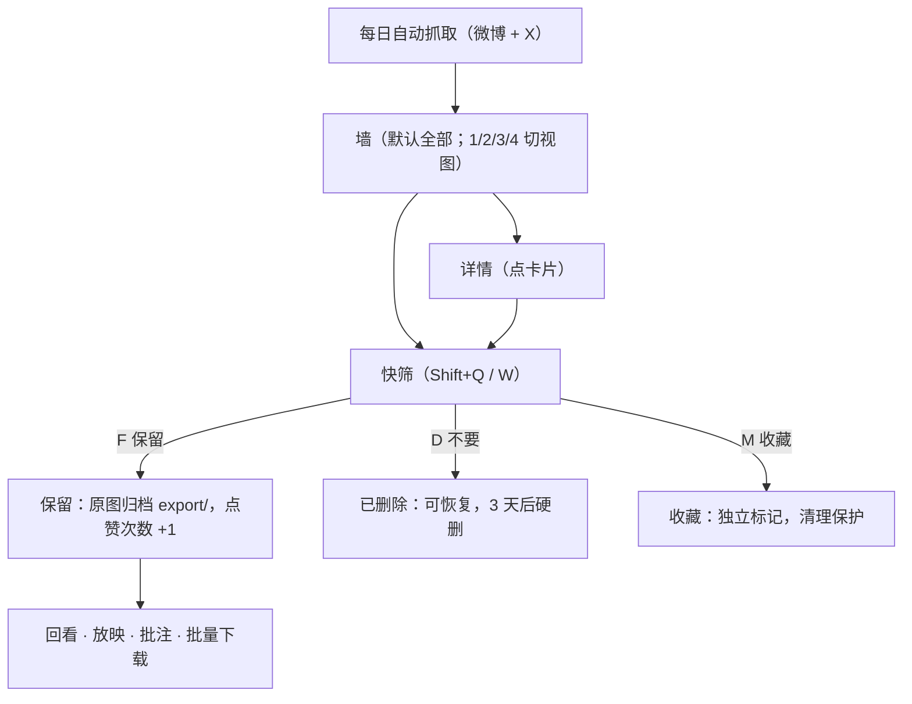
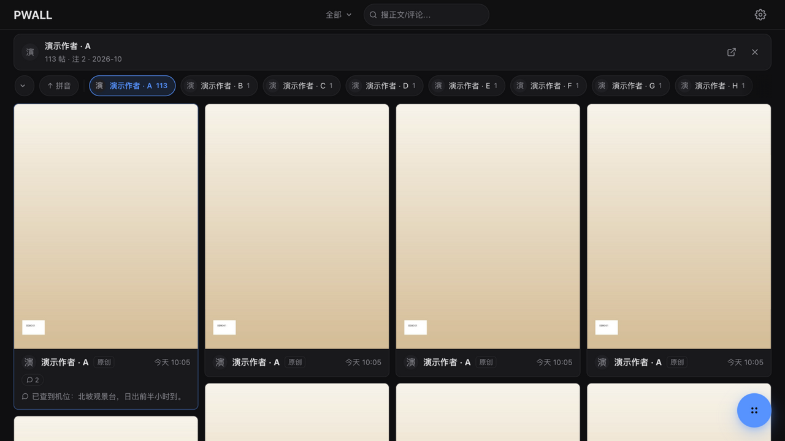
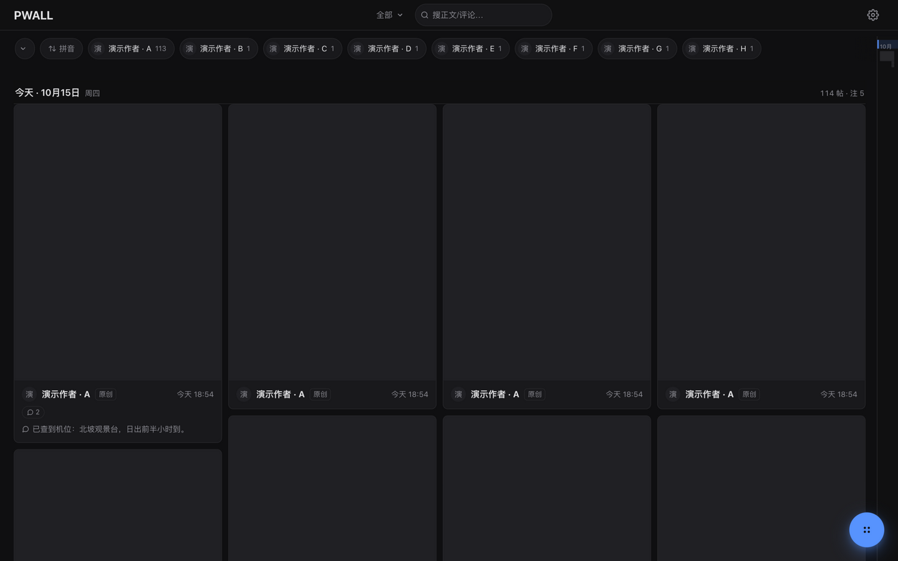
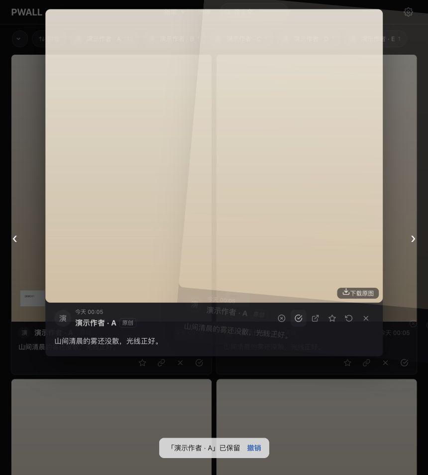
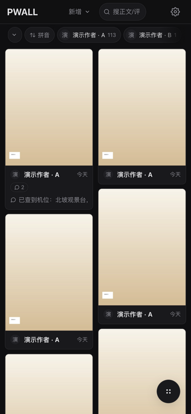

# Picwall 使用手册

> [!note] 本文定位
> 面向日常使用的**完整参考**：每个功能的行为、入口与键位按节查阅；快速上手与配置见 [README](../README.md)。
> 功能或交互变更时随功能提交同步更新本文（更新规则见 README §8）；行为以代码为准。
> 本文只讲「怎么用」；系统结构见 [架构总览](architecture.md)。
> 内嵌截图取自 `verification/` 各轮验收存档（时点见图注、均为演示数据），界面以当前版本为准。

**使用闭环**（抓进来 → 过一遍 → 决定 → 归宿）：

## 1. 墙与视图

回答「怎么看图、怎么切视图」。

### 1.1 墙卡

- 默认显示**全部**图片；「新增」（待筛）在桌面左轨有常驻视图行（点开即浏览未分拣的墙，面板行带实时计数），逐张裁决仍走快筛（§2）。
- 卡片是 XHS 式三段：首图原比例展示（多图帖右下角「N 图」胶囊）→ 标题行（正文开头一行截断）→ 作者行（头像 + 名字 + 点赞）。**视频帖**卡面是海报静帧 + 左下角「▶ 时长」徽标，点击进详情播放。
- 点卡片任意位置进**详情**（§2.2）。
- **点赞 ♥ N**（作者行右槽，数字在心左）：点赞次数。已保留帖点心 = 点赞 +1，**每帖每天一次**（当日已赞实心，再点提示明天再来）；未分拣/已删除帖点心 = 直接保留建账。
- 桌面把鼠标悬到图上，右上角浮出 **☆ 收藏钮**；触屏没有悬浮，收藏钮**常显**在图面右上角（也可进详情按 `M`）；「图片待补齐」的帖图面左上角有小角标。加载失败的图显示「图片缺失」占位图（不露破图，补抓成功即恢复）。
- 滚到底自动加载下一页；「加载更多」按钮保留（键盘/读屏可用）。
- 列表用稳定游标翻页，过期筛选请求自动取消、按帖子 ID 去重，同秒帖子按 ID 排序。

### 1.2 视图切换

| 键 | 视图 |
|---|---|
| `1` | 保留 |
| `2` | 已删除 |
| `3` | 收藏 |
| `4` | 全部 |

- 切换时**清空伴随筛选**（博主、来源、标签、搜索归位默认），只保留视图本身；若切换前有筛选在生效，会弹提示并可**「撤销切换」**一键还原整墙（视图 + 筛选一起回到切换前）。
- 收藏页收所有收藏帖（无论保留/删除状态，状态标记照常显示）。
- **桌面左轨**：视图顺序即键位顺序（新增 → 保留 `1` → 已删除 `2` → 收藏 `3` → 全部 `4`，悬停图标显名条）；展开导航面板后视图行带**实时计数**与键位徽章。
- **导航面板**（左轨「»」钮展开/收起）：分组行拆两处——**折叠箭头**只管展开/收起组员列表（可反复收起），**行体**管选中过滤（选中即自动展开组员，再点取消过滤但保持展开）；面板开合支持 `Esc` 与**点击面板外**收起（收起是会话级的，左轨「»」钮上的展开偏好跨刷新保留，点掉面板下次进来仍按偏好展开）。
- **视图面板**（状态/来源/博主/标签/排序/布局）：桌面入口在右轨「**筛选**」按钮，或 `Shift+F`；点来源/博主胶囊不会误关面板（点面板外或 `Esc` 才收）。
- 视图面板「来源」行可只看微博 / 只看 X（墙卡与视图面板都带 X 标记）；`Shift+F` 直接呼出/收起面板。
- **排序**（桌面）：右轨顶部「排序」按钮，悬停或**点按**出三档抽屉（触屏设备没有悬停，点按同样可用）——「按最新」（时间序）、「按点赞」（保留次数多在前）与「按随机」（打乱顺序），与手机视图面板排序段同全集；当前档高亮，选完自动收抽屉。仅保留/收藏/全部视图可排序（已删除视图图标淡显、点了会提示）；手机端排序仍在视图面板的排序段。
- **搜索**（桌面）：右轨「搜索」按钮点开即落焦点，回车应用；搜索词在生效时图标点亮、名条显当前词，Esc 依次为**还原未生效草稿 → 清除已生效词 → 失焦**。

### 1.3 博主筛选（视图面板）

- 视图面板「博主」行是筛选博主的唯一入口：未筛选时显示「全部博主 ▾」，点击在面板内展开**搜索 + 列表**选择器——列表按**拼音顺序**排列，按首字母分组（联系人式），右缘有 `A`–`Z`/`#` 索引轨：点字母直接跳到该组、按住上下扫动连续跳；输入名字或 `@handle` 即时过滤（搜索时退化为扁平结果），点选即应用。
- 已筛选时胶囊显示头像 + 名字，✕ 一键回全部；计数跟随当前视图（保留/已删除/收藏/全部各算各的）。
- 语义是**当前状态内**看某博主（叠加一个筛选维度，不动来源/搜索）；墙顶同步出现博主统计条。旧链接的分组/时间/评论参数仍会被解析，但没有面板入口，「重置筛选」可清。
- **添加新博主 / 列表**：齿轮「管理分组」提供博主添加入口——微博填入博主 UID 或主页链接（`wbu:<uid>`），X 填入 `@handle`（`xu:<handle>`）；服务端校验存在并自动获取昵称入库，随后进入面板博主选择器。

### 1.4 博主视图

- 点卡片或详情里的**博主头像**进入；桌面也可以走左轨「**所有博主**」——展开导航面板的博主列表（按帖数排序，行尾即帖数），**点任意博主行直接进入他的博主页面**（列表只管「看这位博主」，状态内过滤仍归 §1.3 的视图面板）。
- 进入后状态切到「全部」，其余伴随筛选归位。
- 墙顶博主条：头像/昵称 + 帖数/保留/收藏/批注统计与时间跨度，外链直达原主页；微博作者悬停带签名。
- ✕ 退出整组，还原**进入前**的视图与筛选；`?author=…` 链接可直接分享/收藏。
- 与面板筛选的区别：面板是**当前状态内**叠加博主维度，博主页面是**跨状态看全部**（进/出带还原）。
- 编年布局下同样可用（得到该博主的编年流，日卷粘滞头自动让位博主条）。
- **样式切换**：博主条右侧「卡片 / 胶片 / 展厅 / 蓝图」四选一。后三档都是单列沉浸细看（不随明暗主题、自带整套配色），选择按**偏好记忆**，跨博主、跨会话保持；卡片态为默认。编年布局优先于皮肤（皮肤类自动让位）。
  - **胶片** = 底片印样墙：暗房灯桌底、连续齿孔胶片条、每帖一格（整幅照片做框）、琥珀色边缘码行（框号 01A ▸ 作者名 + 平台戳，保留/收藏转写为行首 3px 色旗）。
  - **展厅** = 白盒画廊个展墙：暖白石膏墙、每帖一件装裱作品（细木框 + 白卡纸留边）、衬线展签带作品号（No. 01）；保留帖展签盖「入藏」绿章，收藏帖画心左下亮金星标。
  - **蓝图** = 青晒图纸档案：普鲁士蓝方格网底、白细线图版框（题块双线框 + 图末落款）、画心白衬纸贴片与四角套准刻线、等宽注记行带图版号（图版 01）；保留/收藏为注记行首 3px 亮绿/亮金色旗。

### 1.5 编年视图（桌面端）

- 入口：视图面板「布局 → 编年」或 `V`；手机端隐藏尺子与切换入口。
- 右缘一条**时间密度尺**：一天一刻度，高度=当日帖数、蓝段=保留占比、金点=有收藏，月份标签跨年带年份。
- 按住拖动出现日期气泡，松手穿越到那天（目标日未装载会自动逐页装载）；当前看到的日子在尺上以 accent 括号标记并跟随滚动。
- 左侧**按日成卷**：日头显示 抓/留/★/注 统计（今天/昨天相对日期），滚动时钉在顶栏下；卡片交互与墙一致（点卡进详情、收藏/保留语义不变）。

### 1.6 纯图模式

- 悬浮球切换；卡片只留图片，点图直达**大图**。
- 大图 `←→` 或左右滑动**跨帖连看**：一帖的图走完自动接下一帖首图。

### 1.7 报刊亭（博主杂志墙）

- 入口：左轨「**报刊亭**」，或直接开 `/kiosk`；独立页，任何已配对设备可看。
- 每位博主是一本「杂志」：期号 `VOL.N` = 发帖数，条码旁盖章区分平台（X PRESS / WB PRESS），封面用他**最新一张图**；刊期角标按近 30 天更新数派生（日刊連載 / 週刊 / 半月刊 / 月刊 / 季刊），发帖最多的博主自动贴「特大号合订本」爆炸贴。
- **点击封面翻开专栏内页**：左页是档案（主笔简介 + 期数/保留率/近 30 天/到货/创刊），右页是最新 4 图的作品版面 + 卷首语（最新一帖文案，链接自动剥离）。
- 「主笔简介」来自平台简介的**本地缓存**；缺失时显示「专访进行中」占位，并在翻开的瞬间自动补拉一次（微博 / X 均支持，拉不到不打扰）。
- 页眉跑马灯是自动生成的到货快讯：本期上架数、特大号、新刊创刊（首帖 90 天内）、連載日刊、全收藏金印（保留率 100% 且 ≥20 期的博主）。
- 纯浏览页：无分拣、无写操作；`Esc` 合上杂志。

### 1.8 标签（打标与筛选）

- 标签是**自定义归类维度**（如「风景」「装机图」），与保留/不要/收藏正交：打标不改决定状态，删帖不清标签（跟随帖子一起被硬删）。
- **打标**：详情右栏正文下方「**＋ 标签**」→ 输入标签名回车（≤24 字，每帖最多 10 个）；已打的标签悬停出 ✕ 可移除。
- **按标签看图**：筛选面板（`Shift+F`）新增「**标签**」行，多选 chip——勾多个标签 = 任一命中即入选；「全部」清空标签筛选。标签 chip 带帖数，打标后即时刷新。
- **批量打标**：多选模式底栏「**标签**」→ 勾选已有标签或输入新标签 →「应用」；超出每帖 10 个上限的帖自动跳过并在提示里说明。逐帖移除仍走详情标签区。
- 标签筛选随 URL 同步（`?tags=`），视图可收藏、可分享；换视图/重置筛选会把标签一并归位。
- 只读设备不能打标（详情无 ＋ 钮、多选无标签按钮），但可以按标签筛选看图。

### 1.9 统计室（回看报告）

- 入口：左轨导航面板「**回看统计**」，或直接开 `/stats`；独立深色页，任何已配对设备可看。
- 四段报告：**总账**（入库/待处理/保留/已删除/收藏/图片/批注/标签计数）、**近 30 天**每日入库与回看点赞双柱图（悬停看当日数值）、**最勤博主**（按保留数前 8，含收藏与总帖数）、**最常点赞 TOP 9**（×N 徽章九宫格，缩略图即墙图）与**回看累计**（点赞次数/出场次/活跃天数）。
- 全部数字来自本地数据库纯聚合，不出网；标签计数含全部标签，图片数含缩略关系行。
- 纯浏览页：无操作入口；点赞次数口径与卡上 ×N 一致（含保留建账的 ×1）。

## 2. 分拣（快筛）

回答「保留 / 不要怎么决定」。分拣动作只发生在快筛与详情，墙卡本身不承担决定。

- 悬浮球可拖动：按住拖到任意位置（位置自动记忆、窗口缩放自动夹回屏内）；球在上半屏时菜单向下展开。**单击球身**也可开合菜单（鼠标/触屏/键盘一致——鼠标悬浮展开时单击即收）。
- 「快筛」是单一入口：桌面（≥641px 宽）直接进**四格快筛**（`Shift+Q` / `Shift+W` 同效）；窄屏/触屏退回**单卡详情流**——切到新增队列点开第一张，用底栏按钮或左右滑动裁决（与详情同一套交互）。

### 2.1 四格快筛（桌面专属）

- 入口：悬浮球 →「快筛」、右轨底部的**待筛**按钮（有待筛帖才出现，徽章即待筛数，筛完自动隐藏），或 `Shift+Q` / `Shift+W`；只读设备无此入口。
- 2×2 居中大卡、四张固定卡位，主题色描边框是当前裁决对象，裁完自动跳下一格。
- 聚焦格带主题色描边 + 泛光 + 「裁决中」角标，其余三格自动压暗；裁决只走键盘（鼠标不参与分拣），底部有**常驻键位提示条**，右上角 **✕ / `Esc`** 退出。
- 多图帖的卡面自动轮换：聚焦格每 3 秒、非聚焦格每 1.2 秒（细看态让位手动 `←→`）。
- 卡面按比例三档适配：正常图**整图呈现**，竖长图**顶部锚定**预览，横全景居中；角标（「长图 / 全景」）明示没看全的帖子，深入走空格/回车。
- 键位：`↑`/`F` 保留、`↓`/`D` 不要（裁一张补一张，幽灵飞出 + 新帖补位）；`Z` 撤销上一笔（原帖回格、补位帖退回队首，6 秒内）；`←→` 换格先看；`空格` 开当前格**正在轮换到的那张**的大图（盖在四格上，`Esc` 逐层退回）；`回车` 细看单张（正文 + 多图 `←→`，照样 F/D 裁决）；`M` 收藏、`L` 原帖、`Esc` 逐层退出（大图 → 细看 → 会话）。

### 2.2 详情 = 单卡快筛

- 布局：左图右栏双栏卡——正文 + 图舞台 + 右栏评论区（§4.2）+ 底栏输入框旁并排 保留/不要/收藏。
- 图舞台：多图用圆点/悬停箭头切换；`←→` 切本帖图、350ms 内同向双击翻帖、`PageUp`/`PageDown` 直接上/下一帖、`空格` 开**正在看的那张图**的大图（切到第几张就开哪张）。
- 键位：`F` 或 `↑`=保留，`D` 或 `↓`=不要，标记后自动到下一张；保留态下 `+`/`-`=点赞次数增减（±1 不前进；`+` 受**每帖每天一次**限，回看态 `+` 即点赞）；`M` 收藏、`L` 原帖、`T` 写批注。
- 鼠标拖拽卡片：左=不要、右=保留；触屏不承担滑动分拣，决定走底栏按钮。
- 关闭：卡外点击或 `Esc`（手机全屏保留 ✕）。

### 2.3 撤销、清理与恢复

- 「保留」「不要」后底部都有 **6 秒撤销**（toast）；撤销=恢复操作前状态与时间，不影响收藏，已归档副本继续保留。提示为**栈式**：连续裁决时带「撤销」的提示不会被后续状态消息顶掉（窗口内始终可点，同屏最多 3 条）；悬停提示暂停倒计时，常驻提示可点 ✕ 手动关闭。
- 其他设备已经修改时，撤销会提示刷新并保留更新的操作（决定版本单调递增，防跨端旧撤销覆盖）。
- 删错了切「已删除」视图可一键恢复。
- **「不要」超过 3 天（`PURGE_DAYS` 可配）每日 04:10 自动硬删**；收藏帖受保护（取消收藏后重新计时）；图片文件带引用计数保护，不误删共享图。
- 写过批注的帖**豁免 3 天自动清理**（图片可重抓、写下的字不可再生），删光评论即恢复清理资格。

## 3. 大图与放映

### 3.1 大图

- **默认只看当前卡片这一帖的图**，左右切换不跨到别的帖子、到头即停。进入：卡片流按 `空格`（视口里最显眼的一张），或纯图模式下直接点图。
- **视频在大图里可内嵌播放**（controls 拖动条，封面为海报；切走即停播），缩放手势对视频不生效。
- 纯查看：`←→` 切换（相邻图已预加载）、`M` 收藏、`L` 打开原帖，`Esc` 或点图外空白关闭。
- **长图按宽度适配、上下滚动阅读**（contain 下长图只是细线）：`↑`/`↓` 或滚轮/触摸滚动，切图自动回顶。
- 大图打开时**筛选快捷键不生效**（F/D/↑/↓ 不会误标记），关掉大图才恢复。
- 跨帖连看只在**纯图模式**：一帖到头自动接下一帖首图（`←→` / 左右滑动同口径）。

### 3.2 放映

- 入口：悬浮球 →「放映」，把**当前视图的筛选结果**全屏自动翻页欣赏——配合筛选就是「某博主精选放映」「某天放映」。
- 幻灯片机式淡入淡出换片，配呼吸微缩放与底部计时线；停留满 2 秒（或暂停/收藏）的保留帖静默计一次「点赞」（同样受每帖每天一次上限），喂给按点赞排序——首次放映会 toast 说明这条计次规则。
- 操作：单击或 `空格` 暂停/继续，`←→` 手动翻，`M` 收藏（左下星标即时点亮），`Esc` 或右上 ✕ 退出。
- 片单上限=个性化「回看数量」档；间隔（3/5/8 秒）与顺序（顺序/随机，套图保持连播）在个性化里调。
- 你写的**批注以字幕形式随图重温**（个性化「放映评论」可关）；鼠标静止 2.5 秒自动藏光标与关闭钮。

## 4. 收藏、批注与回看

### 4.1 收藏

- 标记：桌面墙卡图面右上角的悬浮 ☆、大图/详情/放映按 `M`。独立标记，不改变保留/删除状态；删帖不清收藏，且**受自动清理保护**。
- 工具栏「收藏」标签页=所有收藏帖；在此页打开批量下载即按收藏导出（同一套去重与命名规则）。
- 范围内带批注的帖会附一份 `评论.txt`（帖头 + 首发时间 + 批注正文，"> " 引用协议原样）。

### 4.2 批注（评论）

- 位置：详情浮层右栏，一帖多条、旧→新，每条带**首发时间**（编辑不漂移），纯文本限 500 字。
- 键位：`N` 聚焦输入框，`Enter` 发送、`Shift+Enter` 换行。
- 单条 编辑/删除：桌面悬停显形，手机（触屏）常显；**删除两步确认**（点一下变「确认删除」，3 秒内再点才删，超时自动复原）。
- 评论区是**时间轴**（细线节点，最新一条点亮），跨期自动按 今天/七天内/更早 分节。
- 在正文里**选中一段文字**浮出「引用批注」，写入 `> ` 引用块渲染成灰底引文——对一句话写边注。
- 批注入口在详情右栏（墙卡不再带评论角标）；只读设备看不到输入框。
- 搜索框同时搜**正文和评论**，**回车才应用**（输入过程不刷新列表）。

### 4.3 批注流

- 入口：悬浮球 →「批注」——全库批注按时间倒排成一条流（"我这周在想什么图"）。
- 每行带帖缩略图/作者/时间，点行直达该帖评论区；滚动到底自动续页。

### 4.4 回看

- 入口：桌面端（≥900px）右上「更多」菜单 →「回看」，手机端悬浮球 →「回看」；把保留过的图重新过一遍；每次点击实时选出固定数量（个性化：10/30/100 张，默认 30）。
- **键位与普通详情完全一致**：`F`/`↑` = 点赞 +1、`D`/`↓` = 点赞 −1（±1 不前进，相向按键即互为撤销；`+` 受**每帖每天一次**限）；`←→` 切本帖图、350ms 内同向双击翻帖、`PageUp`/`PageDown` 直接上/下一帖、`空格` 开正在看的那张图的大图；`M` 收藏、`L` 原帖、`T` 批注；拖拽右=+1、左=−1（同样不前进）。
- 组读到底**自动取下一组续刷**（与墙流自动补页同一心智），顶部进度「n / total」随组增长；`Esc` 随时退出。
- 选组规则：点赞次数 ≥2 的帖占前席（按点赞降序），只保留过一次的按保留时间最早补位；同组内 7 天内看过的不会立刻重复。
- 回看复用详情卡，时间旁的「×N」小徽章从第二次点赞起显示，颜色随点赞次数升温：×2 灰 → ×3-4 主题色 → ×5-9 收藏金 → ×10+ 墨底反白。
- 保留/收藏/全部视图的筛选面板可把排序切成「点赞」（点赞降序 → 时间降序）或「随机」（种子洗牌，见下）；编年布局下该排序段收起（点赞/随机都不打时间序）。
- 「随机」= 服务端按种子把命中集合确定性洗牌：默认「每次打开」一套新洗法（同一会话翻页稳定、刷新不跳变，新开标签即重洗）；齿轮「卡片交互 → 随机洗牌」可切「每天一换」——多设备当天同一洗法，次日自动换。大图浏览与放映片单跟随墙上的随机序；新增（待处理）视图不参与随机（快筛/四格保持时间序）。

## 5. 下载与归档

### 5.1 批量下载

- 入口：齿轮「批量下载」打开配置浮窗——范围（已保留 / 全部帖子 / 我勾选的）+ 细分（全部 / 按博主 / 按日期），实时合计。
- **长按任意卡片进入多选模式**（桌面鼠标按住同样有效），或悬浮球 →「多选」显式进入（`Esc` 退出）：点卡片勾选，底部操作栏：全选 / 批量保留 / 批量不要 / **标签**（批量打标） / 下载 / 退出。
- 视频帖在包里永远是**原 mp4 文件**（即使勾了「使用缩略图」也不会给成海报图）；保留归档同口径。
- zip 内按文件路径全局去重，统一命名 `日期_作者_原博ID_序号.扩展名`。
- **单包最多 500 帖**，超出会提示按博主或日期分批——服务端拒绝静默截断；预览、筛选与 ZIP 共用文件计划，图片数按可用文件去重。
- 点「批量下载」后走**打包任务**：面板实时显示「打包中 done/total」，完成后自动交给浏览器下载（`picwall-batch.zip`）；打包失败会给出原因并可重试，关闭页面不影响后台打包。

### 5.2 保留归档（export/）

- 「保留」的原图自动复制进 `data/export/<保留日期>/`——这个文件夹就是留存文件夹，想进手机相册/网盘就同步它。
- 跨日期自动去重（同一张图只归档一次）；「保留」视图里也有**当日打包下载**（zip）。
- 归档文件夹里的 `评论.txt` 随批注增改删自动重建——补写的批注也会进归档（该日不再有带批注的保留帖时文件移除）。
- 保留成功但归档失败会单独提示，顶部可重试归档；缺失的归档副本可从原图重新生成。

### 5.3 缺图补抓

- 部分图片下载失败的帖子标记「图片待补齐」，失败 URL 进本地重试队列：每 4 小时自动补抓（每帖最多尝试 3 次、每轮最多 100 帖），顶部「补抓图片」可手动重试。
- 补抓保持原保留/收藏状态，保留帖会同步补归档；全部图片失败的帖子暂不进入图片流，但仍留有重试任务。

## 6. 手机端

### 6.1 访问

- 同一 Wi-Fi 下浏览器开 `http://<Mac的局域网IP>:8082`；IP 会变就在路由器给 Mac 做 DHCP 保留，或用 `http://<Mac名>.local:8082`（iOS/安卓都认；`.local` 名需先登记 `PICWALL_ALLOWED_HOSTS`）。
- 任何地方访问：Mac 和手机各装 [Tailscale](https://tailscale.com)（免费）走加密隧道，不把服务暴露公网——8082 明文链路上的会话与凭据建议都走它。
- 最方便的连接：Mac 上点右上角二维码图标，手机扫码——地址自动生成；换网络后在弹窗输入框改成新 IP，二维码即时刷新（用 localhost 打开时二维码自动用局域网 IP 和 8082）。
- **加到主屏**（Safari 分享 → 添加到主屏幕）后全屏打开，接近原生 App。
- 手机墙是双列瀑布流（窄列自动收紧头像/字号）；评论的 编辑/删除 常显可点（删除仍是两步确认）。

### 6.2 手势速查（滑错 6 秒内可撤销）

| 位置 | 手势 | 效果 |
|---|---|---|
| 大图 | 左右滑 | 切换图片（仅当前卡片内的图；纯图模式下跨帖连看） |
| 大图 | 双击 | 原图缩放，缩放态单指平移 |
| 卡片流 | 长按 | 进入多选模式 |

- 大图手势只在触屏生效；详情分拣走底栏按钮；卡片流上没有滑动决定（墙是纯浏览）。
- 屏幕边缘留白不干扰系统返回；编年的尺子与切换入口在手机端隐藏。

### 6.3 iOS 存图

- 单张：长按图片「存储到照片」。
- 批量：打包 zip 存到「文件」App → 全选 → 分享 → 存储图像。

## 7. 键位与指针速查总表

桌面端键位按界面分列（手机端不适用；四格仅桌面）。

| 界面 | 键 / 指针 | 动作 |
|---|---|---|
| 墙卡流 | `1` `2` `3` `4` | 保留 / 已删除 / 收藏 / 全部 |
| 墙卡流 | `V` | 切换 编年 / 瀑布 布局 |
| 墙卡流 | `空格` | 开视口中最显眼一张卡的大图 |
| 墙卡流 | `Shift+Q` / `Shift+W` | 进入四格快筛 |
| 墙卡流 | `Shift+F` | 呼出 / 收起筛选面板（状态/来源/博主） |
| 详情 | `F` / `↑` | 保留（标记后到下一张） |
| 详情 | `D` / `↓` | 不要 |
| 详情 | `+` / `-` | 点赞次数增减（保留态；±1 不前进；`+` 每帖每天一次） |
| 详情 | `←→` | 切本帖图 |
| 详情 | 350ms 内同向双击 | 翻上 / 下一帖 |
| 详情 | `PageUp` / `PageDown` | 直接上 / 下一帖 |
| 详情 | `空格` | 开正在看的那张图的大图 |
| 详情 | `M` / `L` / `T` | 收藏 / 原帖 / 写批注 |
| 详情 | `T` | 聚焦批注输入框（`Enter` 发送、`Shift+Enter` 换行） |
| 详情 | 触屏按住拖拽 | 左=不要、右=保留（仅触屏；桌面鼠标不参与轻扫，快筛用 `F`/`D` 或动作按钮） |
| 四格 | `↑`/`F`、`↓`/`D` | 当前格保留 / 不要（裁一张补一张） |
| 四格 | `←→` | 换格先看 |
| 四格 | `Z` | 撤销上一笔（6 秒内） |
| 四格 | `空格` | 当前格**正在轮换到的那张**的大图（盖在四格上） |
| 四格 | `回车` | 细看单张 |
| 四格 | `M` / `L` | 收藏 / 原帖 |
| 回看 | `F` / `↑`（或右滑） | 点赞 +1（不前进；每帖每天一次） |
| 回看 | `D` / `↓`（或左滑） | 点赞 −1（不前进；只赞过一次时提示） |
| 回看 | `←→` / 双击 / `PageUp·Dn` | 与详情同一规则：切本帖图 / 翻帖 / 直接翻帖 |
| 回看 | `空格` | 开正在看的那张图的大图 |
| 回看 | `T` | 写批注（6 秒撤销照常） |
| 大图 | `←→` | 切图（默认限本帖；纯图模式跨帖连看） |
| 大图 | `↑`/`↓` 或滚轮 | 长图滚动阅读（切图自动回顶） |
| 大图 | `M` / `L` | 收藏 / 原帖 |
| 放映 | `空格` / 单击 | 暂停 / 继续 |
| 放映 | `←→` / `M` | 手动翻 / 收藏 |
| 通用 | `Esc` | 退出当前浮层（四格内逐层退回：大图→细看→会话；四格/放映另有 ✕ 按钮） |
| 通用 | `Esc` / 点面板外 | 无浮层时逐层退：右轨抽屉 → 导航面板（点外同样收起；展开偏好不因此改变） |

## 8. 术语速查

跨文档通用的词。与其他文档（架构总览、风险分析）遇到同名概念时以这里为准：

| 术语 | 含义 |
|---|---|
| 墙 / 墙卡 | 图片瀑布流与其中的单帖卡片（图 + 标题行 + 作者行）；点赞可保留/重温，其余纯浏览 |
| 快筛 | 四格集中分拣会话（桌面）+ 详情单卡流的统一入口；窄屏退回详情裁决 |
| 详情 | 单帖浮层：左图右栏（图舞台 + 批注区 + 保留/不要/收藏） |
| 保留 / 不要 | 分拣两态；保留自动归档原图，不要在可恢复期后硬删 |
| 点赞次数（♥N） | 建账=1，此后每帖每天最多 +1（墙卡 ♥、详情 `±`、回看、放映同限），喂「按点赞排序」 |
| 收藏 | 独立标记，不改保留/删除状态，受自动清理保护 |
| 批注 | 写在帖上的文字评论（时间轴、首发时间不漂移）；写过的帖豁免清理 |
| 编年 / 日卷 / 密度尺 | 时间线布局三件套：按日成卷的流、日头统计、右缘时间密度尺 |
| 配对码 / 会话 | 设备接入凭据：码与会话都只存哈希，会话有效期 30 天 |
| 采集令牌 | `make picwall-collector-token` 签发的仅可导入令牌（浏览器代抓用） |
| 内容寻址 | 图片按 sha1 落盘（`pics/年/月/`），同一张图全库只存一份 |
| 归档（export/） | 保留帖原图按日期的留存文件夹，随批注自动重建 `评论.txt` |
| blob 库 | 备份媒体的内容寻址仓库（本地 `data/backups/blobs/` 或夸克网盘） |
| LocalOwner | 本机回环入口注入的管理员身份标记，客户端无法伪造 |
| 墓碑 | 帖子被硬删后的防复活标记，所有入库通道先拦 |
